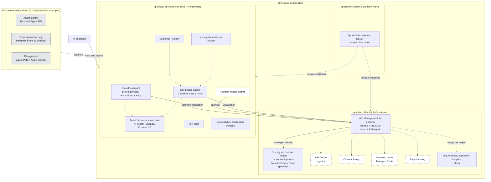

# Foundry Launchpad

A rapid-innovation sandbox that lets AI engineers start building on Microsoft Foundry in minutes, inside guardrails the platform team controls.

## 1. Executive summary

**The problem.** AI engineers want to try Microsoft Foundry now: frontier models, agents and tools. Platform and security teams need every call authenticated, limited and observable before it touches company data. Today that tension is settled by waiting weeks for approvals, or by AI engineers creating their own AI accounts with their own keys, outside any control.

**What you get**

- **AI engineers** start on day one with one gateway URL and one identity.
- **The platform team** stays in control: no model keys held by AI engineers, a limit per project, usage per project for showback, and one governed gateway for every call.
- **Security** gets a defensible baseline: calls authenticated with Entra ID tokens, managed identity to the model, and private networking.

**What this is not.** It is not a platform landing zone. It is a workload that you deploy into your own Azure environment, on top of the landing zone you already run.

**Who it is for.** Platform teams that want to give AI engineers governed access to Foundry.

## 2. Architecture

To keep this reference simple, it uses one Azure subscription with three resource groups.

- A **network** resource group (`rg-network`), owned by the platform team. It holds the spoke VNet, its subnets and the private DNS zones that the other two groups use.
- An **AI hub** resource group (`rg-ai-hub`), owned by the platform team. It holds the AI gateway (API Management) and Microsoft Foundry with the model deployments, plus the services that govern them: a registry, content safety, caching, PII processing and monitoring. Nobody else holds model credentials.
- An **agent landing zone** resource group (`rg-ai-app`), where AI engineers build their apps and agents in their own Foundry projects. Their models come only from the hub, through the gateway, each project with its own identity, token limit and usage numbers.

**Where agents run.** AI engineers can run Foundry-hosted agents in their Foundry project, or self-hosted agents on Azure Container Apps or AKS. Both are designed to call models through the AI hub gateway with an Entra identity that holds the gateway role.

### 2.1 Reference architecture

Dashed boxes are optional. Items marked preview depend on Microsoft preview features. An editable copy of this diagram is in [`docs/reference-architecture.canvas`](docs/reference-architecture.canvas), which you can open in Obsidian.

### 2.2 What each resource group has

| Resource group | Owner | What it has |
|---|---|---|
| **rg-network** (network) | Platform team | **Network:** spoke VNet with peering to the hub, an NSG on each subnet, and a route table sending egress to the hub firewall. **Subnets:** gateway outbound (`Microsoft.Web/serverFarms`), private endpoints, agent apps (`Microsoft.App/environments`), Foundry agent (`Microsoft.App/environments`, `/24`), and AKS if used. **Private DNS zones with VNet links:** `azure-api.net`, `cognitiveservices`, `openai`, `services.ai`, `search`, `documents` (Cosmos DB), `blob`, `azurecr`, `vaultcore`, and the region's `azurecontainerapps.io`. |
| **rg-ai-hub** (AI hub) | Platform team | **AI gateway:** API Management Standard v2, serving models, APIs, MCP servers and A2A agents, with the Responses API and chat completions. **Models:** Foundry account and project with the model deployments. Foundry Control Plane is a Foundry portal capability (preview). **Governance services:** API Center as the registry, Content Safety, and optionally a semantic cache (Azure Managed Redis with an embeddings deployment) and PII processing. **Identity:** the gateway's managed identity, with the OpenAI User role on Foundry. **Operations:** Log Analytics, Application Insights and alerts. |
| **rg-ai-app** (agent landing zone) | AI engineers | **Foundry for development:** a Foundry account with a project per app, for evaluations and tracing. Models come from the hub through the gateway. Hosted agents run here, with the Agent Service's own AI Search, Storage and Cosmos DB. **Self-hosted agents:** a Container Apps environment (or AKS) with the example AI app and agent, and Container Registry Premium. **Identity:** a user-assigned managed identity per project, with the gateway role. **Operations:** Log Analytics, Application Insights and Key Vault. **Optional:** the team's own data stores. |

Each service in the AI hub and the agent landing zone that supports a private endpoint has one, placed in the private endpoints subnet of rg-network.

### 2.3 Provided by your tenant and platform

Launchpad does not deploy the layer at the bottom of the diagram. It assumes your organization already has it.

| Layer | Services |
|---|---|
| **Agent identity** | Microsoft Agent 365 |
| **Foundational security** | Microsoft Defender, Microsoft Entra ID and Microsoft Purview |
| **Management** | Azure Policy and Azure Monitor |

**Out of scope.** This repo does not cover the platform landing zone, Microsoft Entra ID setup, Azure Policy or GitHub. It assumes you already have them and deploys the AI hub and the agent landing zone on top. It also does not deploy user-facing ingress such as Application Gateway with a WAF, knowledge and grounding sources, or a second region.
