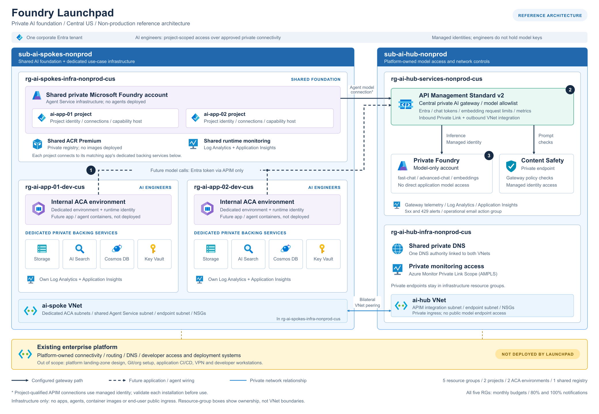
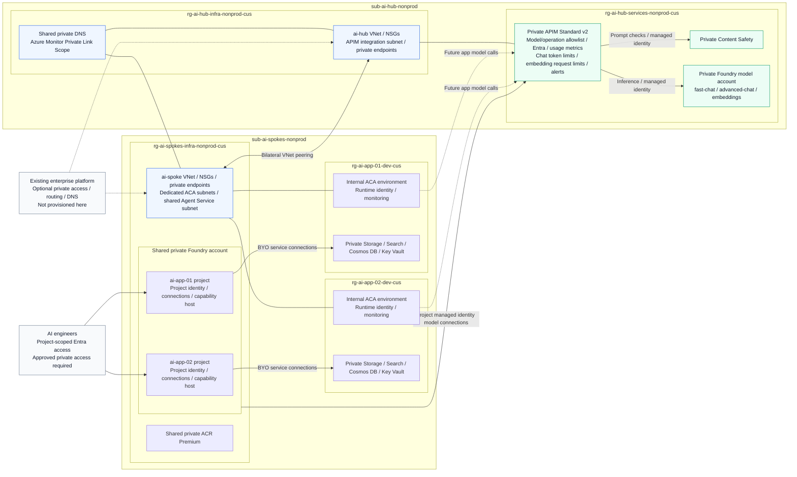

# Foundry Launchpad

## Executive summary

AI engineers need to test ideas quickly. Setting up model access, networking,
identity and data services should not take longer than building a prototype.
Repeating that setup for every use case slows teams down and leaves platform
engineers supporting inconsistent environments.

Foundry Launchpad provides a non-production Azure foundation for AI development.
The platform team owns shared model access and network controls. Engineers get a
workspace with Foundry, data services and infrastructure for future apps and agents.

This phase deploys infrastructure only. It does not deploy apps, agent
definitions, container images or public endpoints for end users.

## Scope

**For platform engineers:** a reference workload to deploy into two existing
Azure subscriptions in one tenant, then hand over governed projects to AI engineers.
It is not a complete platform landing zone or a production certification.

| Included | Outside this repository |
|---|---|
| ai-hub APIM gateway, shared models and gateway policies | Platform landing-zone design, tenant/subscription vending and enterprise Azure Policy |
| ai-spoke Foundry projects, ACA environments and backing services | Application code, agent definitions, business data and knowledge-source integration |
| Workload private endpoints, DNS, identities and scoped service permissions | Developer connectivity/access provisioning: VPN, Bastion, workstations, private runners and corporate-network integration |
| Gateway metrics, basic alerts, budgets and validation tools | Git/org setup, application CI/CD, build/push pipelines and deployment-identity onboarding |

The GitHub workflows here run **source validation only**. They do not set up an
organization or deploy applications/infrastructure. Optional project-group
bindings consume existing Entra groups; they are not a developer-onboarding system.

## What it provisions

Two existing subscriptions in one corporate Entra tenant, in Central US:

- **ai-hub: shared model access and governance.** Hosts the models and the
  central **APIM AI gateway**, including API operations, policies and gateway
  monitoring. The platform team owns the ai-hub.
- **ai-spoke: development workspaces and application infrastructure.** Hosts
  the shared Foundry account and registry, plus a project, internal ACA
  environment and backing services for each use case. Engineers own the app
  resource groups; shared infrastructure stays outside those groups.

The model path is **ai-spoke project or application -> ai-hub APIM -> ai-hub model**.
The ai-app-01 and ai-app-02 applications themselves are not deployed.

### With the default two-app configuration

| Subscription | Resource group | What you get |
|---|---|---|
| `sub-ai-hub-nonprod` | `rg-ai-hub-infra-nonprod-cus` | ai-hub VNet, APIM/private-endpoint subnets, NSGs, private endpoints, shared private DNS and Azure Monitor Private Link Scope |
| `sub-ai-hub-nonprod` | `rg-ai-hub-services-nonprod-cus` | APIM Standard v2, private Foundry model account with three alias deployments, Content Safety, monitoring, gateway alerts and email action group |
| `sub-ai-spokes-nonprod` | `rg-ai-spokes-infra-nonprod-cus` | ai-spoke VNet, peering, dedicated ACA subnets, shared Agent Service subnet, private endpoints, shared ACR Premium, one shared Foundry account with two projects and shared monitoring |
| `sub-ai-spokes-nonprod` | `rg-ai-app-01-dev-cus` | Dedicated internal ACA environment, runtime identity, Storage Standard LRS, AI Search Basic, Cosmos DB serverless, Key Vault Standard and monitoring |
| `sub-ai-spokes-nonprod` | `rg-ai-app-02-dev-cus` | A separate set of the same dedicated application infrastructure |

### Connections and controls included

| Where | Capability | What is configured |
|---|---|---|
| **ai-hub / APIM** | API operations | Chat completions, embeddings and five Responses operations: create, get, delete, cancel and list input items |
| **ai-hub / APIM** | Authentication and model access | Entra token and `Gateway.Invoke` role validation; three-alias model/operation allowlist; managed identity to the model backend, not model keys |
| **ai-hub / APIM** | Usage and safety policies | Chat token limits, prompt safety/Prompt Shield, caller-owned Responses, retries on 429/503; separate embedding request limits |
| **ai-hub** | Gateway operations and monitoring | Caller/model usage metrics, embedding token metrics, gateway logs, and email alerts for 5xx errors and 429 throttling |
| **ai-spoke** | Project connections | Each enabled project connects to ai-hub APIM through `<project>-ai-gateway`, and to its own Storage, Search and Cosmos DB with permissions and capability hosts |
| **ai-spoke** | Workload identity and monitoring | Separate project/runtime identities, scoped permissions and dedicated telemetry per use case |
| **Both** | Private networking | Private endpoints, routing and DNS in the default profile; public workload access disabled after APIM bootstrap. Developer/runner access remains platform-provided |
| **Both** | Cost notifications | Five resource-group monthly budgets with 80% and 100% notifications; budgets are not spending caps |

Terraform manages the gateway Entra application and caller app-role assignments.
Bicep requires the explicit identity-helper steps. Both projects initially share
the same three-model access contract; limits and metrics distinguish caller identities.

The default has five user-managed resource groups, two VNets, two Foundry
accounts, two projects, two ACA environments, one registry, 14 private endpoints
and 15 DNS zones. ACA can also create service-managed resource groups.
Existing enterprise connectivity, security controls and private runners are not
provisioned here. Applying infrastructure does not create applications, images
or agent definitions, run paid smoke tests, or prove end-to-end connectivity.

### Estimated cost

Approximate USD retail baseline for Central US, using the rates checked
October 27, 2026 and 730 hours/month:

| Where | Service | Quantity | Estimated monthly cost |
|---|---|---|---|
| ai-hub | APIM Standard v2 | 1 unit | ~$700 |
| ai-spoke | Shared ACR Premium | 1 registry | ~$51 |
| ai-spoke | AI Search Basic | 2 services | ~$147 |
| Both | Private endpoints | 14 | ~$102 |
| Both | Private DNS zones | 15 | ~$7.50 |
| **Total baseline** | **Before usage and operational extras** | | **~$1,008/month** |
| ai-hub | Chat/embedding model tokens and Content Safety | Usage-based | Additional |
| ai-spoke | Future app compute, Storage, Cosmos DB and Key Vault usage | Usage-based | Additional |
| Both | Logs, alerts, network traffic and DNS queries | Usage-based | Additional |

The three model deployments use pay-as-you-go Data Zone Standard, not reserved
PTUs. Their token charges are **not included** in the baseline. Existing platform
connectivity/runners and future public ingress are also excluded. Budgets notify;
they do not stop spending. Recheck prices before deployment in the
[Pricing Calculator](https://azure.microsoft.com/pricing/calculator/).
This is not an invoice or a capacity guarantee.

### Model access pattern

Model deployments are centralized in the ai-hub Foundry account behind APIM.
The ai-spoke projects consume them through project-level connections, rather than
receiving duplicate model deployments. Both default projects share this catalog:

| Alias / deployment name | Model | Pinned version | Use |
|---|---|---|---|
| `fast-chat` | `gpt-6.1-sol` | `2026-09-29` | Chat; APIM defaults missing Chat Completions reasoning effort to `low` |
| `advanced-chat` | `gpt-6.1-terra` | `2026-10-26` | Complex chat; APIM defaults missing Chat Completions reasoning effort to `high` |
| `embeddings` | `text-embedding-3-large` | `1` | Retrieval/indexing through `/foundry/v1/embeddings`; not an agent chat model |

Each requests Data Zone Standard capacity 10, not reserved throughput. Processing
is within the US data zone, not necessarily Central US. Check model availability,
quota, prices and lifecycle before deployment. `fast-chat` is a workload label,
not a latency guarantee; caller reasoning settings are preserved.

Agent definitions select `<project>-ai-gateway/fast-chat` or
`<project>-ai-gateway/advanced-chat`, for example `ai-app-01-ai-gateway/fast-chat`.
All connection names include the project name to avoid collisions in the shared
Foundry account; the exported readiness settings supply the exact names.
Application code sends the bare alias as `model` to APIM. Alias names are also
the ai-hub deployment names, so no additional routing service or name translation
is needed. No model deployments are made inside the ai-spoke account.
Project and runtime identities have separate caller accounting; the configured
token allowance is per caller, not one pooled project budget.

APIM rejects unknown aliases with 403 and chat/embedding operation mismatches
with 400 before inference. Chat and Responses share the existing caller token
limit for inference (default 10,000/minute), prompt checks and token metrics.
Response retrieval, cancellation and deletion are not charged to that token
counter. Embeddings use a
separate default 60 requests/minute per caller and emit `EmbeddingTokens` from
successful response usage. LLM-specific token limiting and prompt safety policies
are not applied to embeddings; request limits and budgets are not token caps.
Response-ownership checks remain caller-scoped and require the gateway-stamped
chat alias; untagged or foreign Responses are rejected.

Engineer groups receive project-scoped Foundry User access. This deployment
does not grant them model keys or direct inference roles on the ai-hub model account,
and creates no model deployments in the ai-spoke account. This is not a blanket
deny against inherited permissions, new connections or externally deployed models.
The static project list is discovery configuration; APIM separately enforces the
same three-alias contract for every authorized caller. Different model
entitlements per project are not implemented. Stronger restrictions require an
explicit per-project contract and review of effective permissions and platform
controls.

## Architecture

The illustration is an original reference diagram, not a screenshot of a
customer environment. [Editable SVG](docs/reference-architecture.svg) |
[Obsidian canvas](docs/reference-architecture.canvas).

Mermaid architecture source

The five resource groups are ownership boundaries, not VNets. Foundry projects
stay under the shared account; their backing services and ACA environments are
dedicated to each use case. Private endpoints stay in the infrastructure groups.

Solid links show configured relationships in the default profile. Dashed links
show optional platform integration or future application model calls. Each
Foundry project has a `<project>-ai-gateway` connection; an agent must select
`<project>-ai-gateway/<model-deployment-name>`. Apps and agents must use APIM, never the model account
directly. ACR and shared runtime monitoring belong to the ai-spoke foundation;
each use case also has its own telemetry. Existing-network mode uses
customer-managed routing and DNS.

## Technical notes

- **Private by default:** APIM uses inbound Private Link and outbound VNet
  integration. Its initial bootstrap briefly enables public access; the ordered
  endpoint/closure step must finish before use. Never reopen it on redeployment.
- **Existing networks:** BYO mode requires platform-managed routing, DNS,
  delegations and permissions. It does not reuse an existing registry or AMPLS.
- **Trusted non-prod teams:** Foundry account settings, quotas and runtime
  networking are shared. Dedicated app resources do not provide hard tenant isolation.
- **Bounded growth:** two apps are the default and live-tested profile. Inputs
  allow up to 10 use cases within the reference `/26` private-endpoint subnet;
  this is an IP-capacity guard, not a tested service-scale guarantee.
- **Foundry integration:** project-managed-identity APIM connections use chat
  completions. They are separate from resource-wide portal gateway onboarding.
  Some APIs use preview contracts; validate the chosen model and tools.
- **Platform responsibilities:** private developer connectivity, egress control,
  residency requirements, application delivery and production resilience stay
  outside this workload. Private endpoints alone do not supply them.

## Validation and limitations

The default Bicep profile has been deployed and checked in Central US with
synthetic data. Live checks covered both runtime identities, both chat aliases,
embeddings, a simple Foundry `fast-chat` agent in each project, private image
push/pull, Storage fixture write/read/delete, Cosmos database metadata, Key Vault
metadata, gateway access denials and caller/model token attribution in logs.
Terraform has offline validation and mocked-provider tests; the current
three-model Terraform profile has not been certified by a fresh live apply.

This is not a full application or production acceptance test. Real Search
indexing/queries, Cosmos document workflows, agent tools, load/failover behavior,
safety/limit saturation and end-user access need workload-specific tests.
The reference environment's action-group test was rejected by Azure as having
no valid receiver; notification delivery remains unverified. Check receiver
verification/eligibility in your tenant, and do not release alerts without a
successful delivery test.

## Release to AI engineers

This is the foundation for developing `ai-app-01` and `ai-app-02`, not a
ready-to-use application environment merely because infrastructure deploys.
Platform engineering should complete this handoff before inviting engineers:

| Release requirement | What the platform engineer must provide |
|---|---|
| Provisioned foundation | A reviewed deployment, reconciled existing identities and passing checks; a protected remote backend if using Terraform |
| Private access | Working developer/runner connectivity and private DNS; no public-access workaround |
| Engineer access | Approved Entra groups with project access. The default group list is empty; a supplied list applies to both projects |
| Application delivery | An approved deployment identity/pipeline with scoped app deployment, runtime identity attachment and registry push permissions; these human/pipeline grants are not provisioned automatically |
| Data and model access | Verify each runtime identity's backing-service access and APIM authorization. Engineers use Foundry agents or an authorized runtime, not model keys; a local human login does not carry the gateway's application role |
| Acceptance tests | Both chat aliases, embeddings, Foundry-to-APIM routing, required tools/data operations, access denials and telemetry; confirm alert delivery |
| Handoff | Project/gateway endpoints, model aliases, registry and environment details, deployment instructions, limits, budgets and an operational contact |

After these checks, engineers can develop and deploy their application code on
the foundation. They still own app logic, agent definitions, tools, data/indexes
and application tests. See the [private-access and smoke-test guide](infra/README.md#private-access-and-agent-smoke-test).

## Get started

Choose **one implementation per installation**; never manage the same resources
with both tools. The guides contain the exact inputs, commands and redeployment rules.

| Implementation | Start here | Important prerequisite |
|---|---|---|
| Terraform | [Terraform guide](infra/terraform/README.md) | Protected remote state backend and Azure/Entra permissions |
| Bicep | [Bicep guide](infra/bicep/README.md) | Explicit gateway Entra preparation and caller-role assignments |

1. Confirm the two target subscriptions, region, private-access prerequisites,
   model availability and costs.
2. Supply real inputs through environment variables or ignored local files;
   never commit tenant values, credentials, state or saved plans.
3. Run offline checks and review a fresh Terraform plan or Bicep what-if.
4. Deploy with approval, verify private-access closure and complete the
   [platform handoff checks](#release-to-ai-engineers).
5. Run [synthetic smoke tests](infra/README.md#private-access-and-agent-smoke-test)
   from approved private connectivity; model calls are explicitly opt-in.

## Links and sources

### Project guides

- [Infrastructure layout, inputs and verification](infra/README.md)
- [Terraform implementation](infra/terraform/README.md)
- [Bicep implementation](infra/bicep/README.md)
- [Editable architecture canvas](docs/reference-architecture.canvas)
- [Architecture image and editable SVG](docs/reference-architecture.svg)
- [Private access, smoke test and operations](infra/README.md#private-access-and-agent-smoke-test)

### Reference implementations

- [Azure Verified Modules: AI/ML landing zone for Foundry](https://github.com/Azure/terraform-azurerm-avm-ptn-aiml-landing-zone)
- [Azure AI gateway landing zone](https://github.com/Azure/terraform-ai-gateway-landing-zone)

### Microsoft documentation

- [Microsoft Foundry architecture](https://learn.microsoft.com/azure/foundry/concepts/architecture)
- [Foundry Agent Service: use your own resources](https://learn.microsoft.com/azure/foundry/agents/how-to/use-your-own-resources)
- [API Management AI gateway capabilities](https://learn.microsoft.com/azure/api-management/genai-gateway-capabilities)
- [API Management outbound VNet integration](https://learn.microsoft.com/azure/api-management/integrate-vnet-outbound)
- [API Management inbound private endpoints](https://learn.microsoft.com/azure/api-management/private-endpoint)
- [Azure Monitor Private Link](https://learn.microsoft.com/azure/azure-monitor/fundamentals/private-link-security)
- [Azure Pricing Calculator](https://azure.microsoft.com/pricing/calculator/)

### Terraform guidance

- [HashiCorp: standard module structure](https://developer.hashicorp.com/terraform/language/modules/develop/structure)
- [HashiCorp: module composition](https://developer.hashicorp.com/terraform/language/modules/develop/composition)
- [HashiCorp: style guide](https://developer.hashicorp.com/terraform/language/style)
