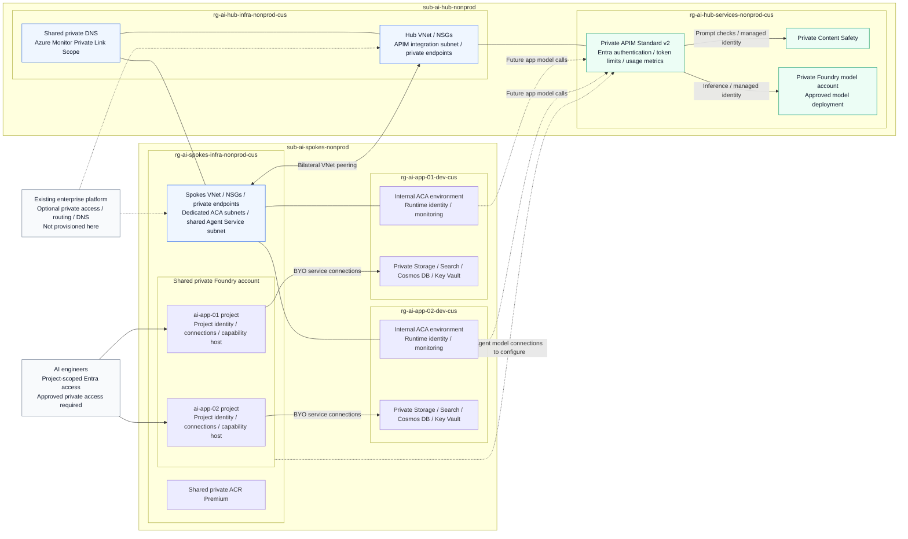

# Foundry Launchpad

## Executive summary

AI engineers need to test ideas quickly. Setting up model access, networking,
identity and data services should not take longer than building a prototype.
Repeating that setup for every use case slows teams down and leaves platform
engineers supporting inconsistent environments.

Foundry Launchpad provides a non-production Azure foundation for AI development.
The platform team owns shared model access and network controls. Engineers get a
workspace with Foundry, data services and infrastructure for future apps and agents.

This phase deploys infrastructure only. It does not deploy apps, agent
definitions, container images or public endpoints for end users.

## What it provisions

Two existing subscriptions in one corporate Entra tenant, in Central US.
The two use cases share one Foundry account and registry. Each gets its own
ACA environment, Foundry project and backing services. The ai-app-01 and
ai-app-02 applications themselves are not deployed.

| Subscription | Resource group | Services | Estimated monthly cost |
|---|---|---|---|
| Existing enterprise platform | Customer-owned groups | Optional connectivity, central DNS, security and private runners; not deployed here | Existing platform costs |
| `sub-ai-hub-nonprod` | `rg-ai-hub-infra-nonprod-cus` | Hub VNet, APIM/private-endpoint subnets, NSGs, private endpoints, shared DNS and private monitoring access | $7.30 per endpoint + $0.50 per DNS zone; traffic and queries extra |
| `sub-ai-hub-nonprod` | `rg-ai-hub-services-nonprod-cus` | APIM Standard v2, private Foundry S0/model deployment, Content Safety S0, identities, inference policies and service monitoring | About $700 for APIM + model tokens, service usage and telemetry; no PTU reservation |
| `sub-ai-spokes-nonprod` | `rg-ai-spokes-infra-nonprod-cus` | Spokes network, dedicated ACA subnets, private endpoints, shared ACR Premium, one Foundry account with two projects and shared runtime monitoring | About $51 for ACR + networking and logs |
| `sub-ai-spokes-nonprod` | `rg-ai-app-01-dev-cus` | Dedicated ACA environment, runtime identity, monitoring, Storage Standard LRS, Search Basic, Cosmos serverless and Key Vault Standard | $73.73 for Search + runtime, data and telemetry |
| `sub-ai-spokes-nonprod` | `rg-ai-app-02-dev-cus` | Dedicated ACA environment, runtime identity, monitoring and document/retrieval backing services | $73.73 for Search + runtime, data and telemetry |

USD retail estimates use Central US rates checked October 27, 2026 and 730
hours/month. One APIM unit, one shared registry and two Search Basic services
are about **$898/month before networking and usage**. This full profile has
14 private endpoints (about $102/month) and 15 DNS zones (about $7.50/month), giving
a fixed estimate of **$1,008/month before usage**. Model tokens, app compute, logs,
data operations, traffic and any future public ingress are additional.
This is not an invoice or a capacity guarantee.
[Pricing Calculator](https://azure.microsoft.com/pricing/calculator/).

## Architecture



The five resource groups are ownership boundaries, not VNets. Foundry projects
stay under the shared account; their backing services and ACA environments are
dedicated to each use case. Private endpoints stay in the infrastructure groups.

Solid links show configured relationships in the default profile. Dashed links
show optional platform integration or model-call paths that require application
or agent configuration. Apps and agents must use APIM, never the model account
directly. ACR and shared runtime monitoring belong to the spokes foundation;
each use case also has its own telemetry. Existing-network mode uses
customer-managed routing and DNS.
See the [editable canvas](docs/reference-architecture.canvas).

## Technical notes

- **Private services:** public access is disabled on the workload services.
  APIM uses inbound Private Link and outbound VNet integration; its subnet stays
  in the platform subscription. ACR needs Premium and Search needs Basic or higher.
- **Networking:** two non-overlapping VNets are peered in both directions. One
  private DNS authority is linked to both networks. The repo creates these
  resources by default, or accepts approved `existing_networks` inputs.
- **Existing platform:** supplied VNets/zones retain their original ownership.
  Existing-network mode requires the customer to supply working routing and DNS.
  It does not automatically reuse an existing registry, logging workspace or AMPLS.
- **Agent readiness:** `enable_agent_infrastructure=true` provisions private
  Standard Agent Service connections, backing permissions and capability hosts.
  No agent is created. ACA and Foundry-hosted code agents are separate runtime
  choices; applications and images belong to a later phase.
- **Identity:** runtime and Foundry project identities are distinct. Model calls
  must go through APIM. Configure engineer group access and validate the selected
  Foundry-to-gateway connection before using an agent.
- **Foundry Control Plane:** use the portal management experience for the shared
  account and projects; it is not an extra RG resource. Built-in gateway onboarding
  currently requires APIM in the same subscription as Foundry. Our central APIM
  stays in the platform subscription, so a supported model connection must be
  configured and tested separately. No second gateway is deployed.
- **Isolation:** each use case has dedicated backing services and application
  namespaces, separate from Foundry's internal stores. Foundry account settings,
  quotas and runtime networking remain shared. This profile is for trusted
  non-prod teams, not mutually untrusted tenants.
- **Public app access:** an end-user app may be public while its backends stay
  private. Each use case has its own ACA environment and subnet; the current profile
  keeps them internal. Public ingress is a separate application-phase decision.
- **Platform checks:** private developer/runner access, egress restrictions and
  business-data residency remain explicit platform decisions. Private endpoints
  alone do not provide them. APIM briefly permits public access during initial
  creation; an ordered update closes it after Private Link approval.
- **Lifecycle:** review actual regional capacity and recurring charges before
  apply. Retain protected Terraform state and use a team-approved remote backend.
  No previous tenant's state should be reused for a new deployment.

## Get started

Supply tenant and subscription IDs through ignored local configuration or
environment variables. The repo provisions resources into existing subscriptions;
it does not create tenants or subscriptions.

Choose [Terraform](infra/terraform/README.md) or [Bicep](infra/bicep/README.md);
do not deploy both over the same resources. Both need Azure CLI and resource/RBAC
permissions in both subscriptions. Directory identity setup differs by tool.
See the [infrastructure guide](infra/README.md) for entry points and prerequisites.

### Terraform

Use Terraform matching [versions.tf](infra/terraform/versions.tf), Python 3 and
Entra application permissions.

```bash
az login --tenant <tenant-id>
cp infra/terraform/terraform.tfvars.example infra/terraform/terraform.tfvars
# Fill in tenant, both subscriptions, contact, model and engineer groups.
terraform -chdir=infra/terraform init -lockfile=readonly
terraform -chdir=infra/terraform workspace new launchpad-nonprod
terraform -chdir=infra/terraform fmt -check -recursive
terraform -chdir=infra/terraform validate
terraform -chdir=infra/terraform test
python3 -m unittest discover -s infra/terraform/tests -p 'test_*.py'
terraform -chdir=infra/terraform plan -out=tfplan
```

Select the existing workspace on subsequent runs. Review subscription placement,
costs and resource changes, then:

```bash
terraform -chdir=infra/terraform apply tfplan
bash infra/terraform/test.sh
terraform -chdir=infra/terraform plan -detailed-exitcode
```

`terraform test` is offline and uses mocked providers. `test.sh` checks the live
infrastructure through read-only management APIs: tenant/subscription boundaries,
private access, endpoint approval, peering, DNS, monitoring and model provisioning.
It does not run agents/apps, read keys or perform paid inference.

A passing infrastructure test is not a packet-flow or application test. Model
calls, image pulls, private runtime DNS, evaluations and telemetry delivery need
separate validation once an application is added.

### Bicep

Prepare the gateway's Entra application and caller authorization as described in
the [Bicep guide](infra/bicep/README.md). Then compile the subscription deployment:

```bash
az bicep build --file infra/bicep/main.bicep --stdout > /dev/null
```

Supply environment-specific parameters, review a subscription-scope `what-if`,
and deploy only after reviewing scope, permissions and costs.

Subscription display names are `sub-ai-hub-nonprod` and `sub-ai-spokes-nonprod`.
The Terraform inputs `ai_hub_subscription_id` and
`ai_spokes_subscription_id` refer to their IDs respectively. Display-name
changes do not require provider, state or resource-group renames. Here, AI hub
means shared AI services, not an enterprise network hub or a legacy Foundry hub.

## Links and sources

### Project guides

- [Infrastructure layout, inputs and verification](infra/README.md)
- [Terraform implementation](infra/terraform/README.md)
- [Bicep implementation](infra/bicep/README.md)
- [Editable architecture canvas](docs/reference-architecture.canvas)

### Reference implementations

- [Azure Verified Modules: AI/ML landing zone for Foundry](https://github.com/Azure/terraform-azurerm-avm-ptn-aiml-landing-zone)
- [Azure AI gateway landing zone](https://github.com/Azure/terraform-ai-gateway-landing-zone)

### Microsoft documentation

- [Microsoft Foundry architecture](https://learn.microsoft.com/azure/foundry/concepts/architecture)
- [Foundry Agent Service: use your own resources](https://learn.microsoft.com/azure/foundry/agents/how-to/use-your-own-resources)
- [API Management AI gateway capabilities](https://learn.microsoft.com/azure/api-management/genai-gateway-capabilities)
- [API Management outbound VNet integration](https://learn.microsoft.com/azure/api-management/integrate-vnet-outbound)
- [API Management inbound private endpoints](https://learn.microsoft.com/azure/api-management/private-endpoint)
- [Azure Monitor Private Link](https://learn.microsoft.com/azure/azure-monitor/fundamentals/private-link-security)
- [Azure Pricing Calculator](https://azure.microsoft.com/pricing/calculator/)

### Terraform guidance

- [HashiCorp: standard module structure](https://developer.hashicorp.com/terraform/language/modules/develop/structure)
- [HashiCorp: module composition](https://developer.hashicorp.com/terraform/language/modules/develop/composition)
- [HashiCorp: style guide](https://developer.hashicorp.com/terraform/language/style)
