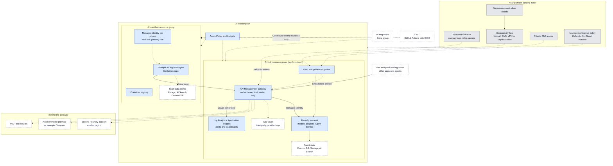
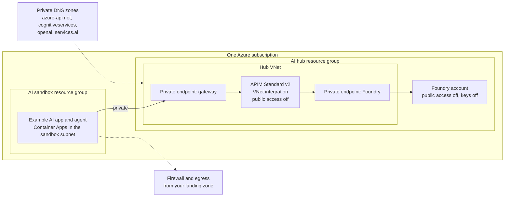

# Foundry Launchpad

A rapid-innovation sandbox that lets AI engineers start building on Microsoft Foundry in minutes, inside guardrails the platform team controls.

## 1. Executive summary

**The problem.** AI engineers want to try Microsoft Foundry now: frontier models, agents and tools. Platform and security teams need every call authenticated, limited and observable before it touches company data. Today that tension is settled by waiting weeks for approvals, or by AI engineers creating their own AI accounts with their own keys, outside any control.

**What you get**

- **AI engineers** start on day one with one gateway URL and one identity.
- **The platform team** stays in control: no model keys outside the hub, a limit per project, usage per project for showback, and one place to apply policy.
- **Security** gets a defensible baseline: Entra ID authentication, managed identity to the model, private networking and Azure Policy guardrails.

**What this is not.** It is not a platform landing zone. It is a workload that you deploy into your own Azure environment, on top of the landing zone you already run.

**Who it is for.** Platform teams that want to give AI engineers governed access to Foundry.

## 2. Architecture

To keep this reference simple, it uses one Azure subscription with an AI hub resource group and an AI sandbox resource group.

- An **AI hub**, a resource group owned by the platform team. It holds Microsoft Foundry and one governed gateway in front of it. Nobody else holds model credentials.
- An **AI sandbox**, a resource group where AI engineers build their apps and agents. They reach Foundry only through the hub, each project with its own identity, token limit and usage numbers.

### 2.1 Reference architecture

The diagram shows the full picture. Blue is what Launchpad deploys. Grey is what your landing zone already provides. Dashed boxes are extension points that plug into the same design.

Extension points are designed into the gateway and the hub, so adding one does not change how projects call the gateway.

| Extension point | Where it plugs in | Note |
|---|---|---|
| Second Foundry account or region | A backend pool behind the gateway, with one independent gateway per region | Stored responses (get, cancel, `previous_response_id`) must reach the backend that created them, so the gateway pins a client to its backend. |
| Another model provider, for example Compass | A second API and backend on the same gateway, with its key in Key Vault | Callers keep one gateway and one identity. |
| MCP tool servers | Published through the gateway, so agents call approved tools only | Same authentication and limits as the models. |
| Foundry projects and hosted agents | In the hub's Foundry account, with the Agent Service on the private network | The agents use your own Cosmos DB, Storage and AI Search for state. |
| Dev and prod landing zones | Call the gateway over its private endpoint | Each app gets its own identity and gateway role. |
| Team data stores | In the sandbox group, behind private endpoints | Owned by the AI engineers. |
| CI/CD | A pipeline with OIDC deploys the hub and the sandbox from pull requests | Adding a project is a pull request. |

### 2.2 What is deployed

| Where | Resources | Purpose |
|---|---|---|
| AI hub resource group | API Management (Standard v2) with the Responses API | The one governed entry point: five operations, streaming, background mode |
| | Foundry account, project and model deployment | The models. API keys are off, and only the gateway's identity can call it. |
| | Log Analytics, Application Insights, alerts on `429` and `5xx` | Gateway logs, usage per project, throttling alerts |
| AI sandbox resource group | Container Apps environment and a container registry | Where AI engineers host their apps and agents |
| | A managed identity per project, with the gateway role | The identity the gateway limits and meters |
| | The example AI app and agent | A small chat app with one Microsoft Agent Framework agent, to copy and extend |
| Microsoft Entra ID | The gateway app registration with its app role, and an Entra group for AI engineers | Who may call the gateway, and who may work in the sandbox |
| Subscription | Azure Policy assignments and budgets | Guardrails, scoped to each resource group |

### 2.3 How a request flows

1. The app asks Microsoft Entra ID for a token for the gateway, using its project's managed identity.
2. It calls the gateway on the Responses API with that token.
3. The gateway checks the token and the gateway role, and learns which project is calling.
4. It applies that project's token limit. Over the limit, the project gets `429` with `Retry-After`; other projects are not affected.
5. The gateway calls Foundry with its own managed identity, retries a short `429` or `503`, and streams the answer back without buffering.
6. Token usage is recorded under the project's identity, for showback and alerts.

### 2.4 Identity and access

| Who | Gets | Where |
|---|---|---|
| Platform team | Owner, or Contributor plus User Access Administrator | The AI hub resource group |
| AI engineers (Entra group) | Contributor | The AI sandbox resource group only |
| A project's managed identity | The gateway app role, which lets it call the gateway and nothing else | The gateway |
| The gateway (APIM managed identity) | Cognitive Services OpenAI User | The Foundry account only |

AI engineers never see a model credential. Foundry API keys are disabled, so the gateway is the only way to the models.

### 2.5 Governance and operations

- **Azure Policy.** Required tags and allowed regions on both groups. In the sandbox, a deny rule for creating Foundry or Azure OpenAI accounts, so nobody can bypass the gateway. On the hub, Private Link required, local authentication disabled and network access restricted.
- **Limits.** A token limit per project protects the shared model quota. The limits are set against the capacity of the model deployment.
- **Cost.** A budget with alerts on the sandbox, and a tag with an expiry date for cleanup.
- **Observability.** Token usage per project, gateway logs and alerts on throttling and errors.

### 2.6 Network profiles

The same design runs in two profiles.

| | `open` | `private` |
|---|---|---|
| Endpoints | Public | Private endpoints, public access off |
| Caller authentication | Entra token | Entra token |
| Intended for | A first trial with non-confidential data | Real use inside a landing zone |

In the `private` profile the hub holds one VNet with a subnet for the gateway's outbound traffic, one for the private endpoints and one for the sandbox. Public access to the gateway is switched off after its private endpoint exists. Private DNS zones come from your platform team, or are created here if you have none.

### 2.7 What you provide

Launchpad deploys a workload, so your environment supplies what a landing zone normally supplies.

- An Azure subscription, with the resource providers registered and quota for the model.
- Permission in Microsoft Entra ID to create an app registration and a group.
- For the `private` profile: address space for the VNet, private DNS zones, and egress through your firewall.
- Any management-group policy and Defender settings your organization already applies.

### 2.8 Key decisions

| Decision | Choice | Why |
|---|---|---|
| Subscriptions | One, as the reference | It is the simplest to read and deploy. The hub and the sandbox can sit in different subscriptions, and the gateway is reached over a private endpoint. |
| Isolation between projects | An identity per project in one sandbox group | One identity gives each project its own limit and usage. Teams that need hard isolation of their resources add a sandbox group per team from the same template. |
| Gateway | API Management Standard v2 | It is the minimum tier that supports a private endpoint, VNet integration and zone redundancy. |
| Authentication | Entra ID tokens, no shared keys | There is no secret to leak or rotate, and every call is attributable to a project. |
| Hosting for apps and agents | Azure Container Apps | A common fit for agents, scales to zero and works with managed identity. Teams are free to host elsewhere. |
| Agents | Code-first agents in the sandbox that call the gateway | Foundry projects and hosted agents can be added in the hub account later without changing the gateway. |
